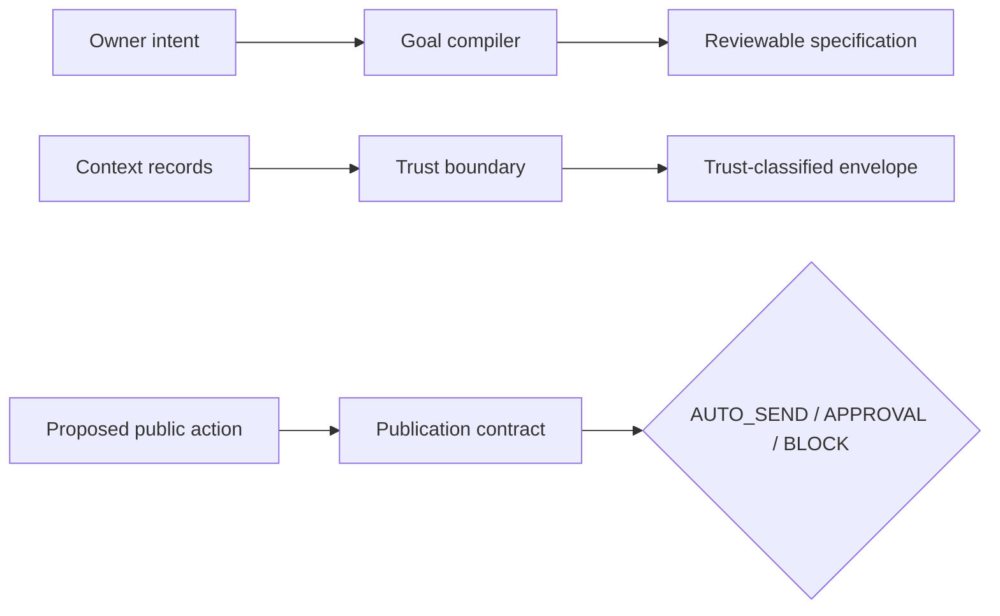

# Architecture

WEFT 2.0 contains three deterministic, independently testable primitives.

The diagram shows data dependencies, not a deployed service. These modules are
reference primitives that a host application may compose.

## 1. Goal compiler

Input: one explicit intent record.

Output: a reviewable goal specification.

The compiler validates scope, tasks, dependencies, write boundaries, evidence
paths, rollback, approvals, and red lines. A `READY` result still has
`execution_authorized=false`.

## 2. Trust boundary

Input: already-supplied context records, their source identifiers, and an
explicit list of trusted deployment policy sources.

Output: a deterministic context envelope.

Only accepted `core_policy` and `owner_intent` entries can act as instructions.
Project facts, project instructions, and external text remain reference data.
The caller remains responsible for authenticating source adapters.

## 3. Publication contract

Input: a proposed action, target, payload hash, owner-intent facts, optional
manifest approval, and risk flags.

Output: `AUTO_SEND`, `REQUIRE_OWNER_APPROVAL`, or `BLOCK`.

The module does not execute actions. A stateful host is responsible for:

- showing the exact manifest to the owner;
- collecting one-time approval;
- enforcing approval expiry;
- scanning current content again before execution;
- placing public-write credentials outside the planning process.

## Non-goals

This repository does not contain:

- an agent runtime;
- an LLM prompt or model call;
- a sandbox;
- a persistent memory store;
- an execution scheduler;
- a source-authentication system;
- a production credential store;
- a hosted public-write service.

## Design invariants

- Missing information is never invented.
- Project text never silently becomes system policy.
- Approval never silently becomes execution.
- A changed payload or target never reuses an old approval.
- Hard-risk findings cannot be overridden by approval.
- Security-relevant decisions are deterministic and testable.
